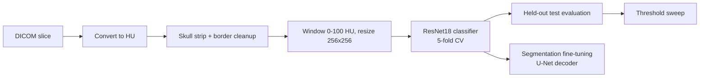

# Brain Stroke CT Classification

Deep-learning pipeline for detecting **intracranial hemorrhage (bleeding)** on non-contrast head CT scans stored as DICOM. The repository contains a preprocessing pipeline based on Hounsfield units (HU), a ResNet18 classifier trained with 5-fold cross-validation, a decision-threshold analysis tool, and a U-Net-style segmentation model that reuses the classifier's encoder.

> **Research code, not a medical device.** Nothing here has been clinically validated and it must not be used for diagnosis or treatment decisions.

---

## Table of contents

1. [What problem are we solving?](#1-what-problem-are-we-solving)
2. [Overview of the approach](#2-overview-of-the-approach)
3. [Dataset](#3-dataset)
4. [Preprocessing in detail](#4-preprocessing-in-detail)
5. [Classification model and training](#5-classification-model-and-training)
6. [Threshold analysis](#6-threshold-analysis)
7. [Segmentation](#7-segmentation)
8. [Repository structure](#8-repository-structure)
9. [Installation](#9-installation)
10. [Configuration](#10-configuration)
11. [Running the pipeline](#11-running-the-pipeline)
12. [Outputs](#12-outputs)
13. [Results](#13-results)
14. [Known limitations](#14-known-limitations)
15. [Troubleshooting](#15-troubleshooting)
16. [Reproducibility](#16-reproducibility)
17. [Roadmap](#17-roadmap)
18. [Data, privacy and license](#18-data-privacy-and-license)

---

## 1. What problem are we solving?

Stroke is caused either by a **blockage** of a brain artery (ischemic stroke) or by **bleeding** into or around the brain (hemorrhagic stroke). The two need opposite treatments: clot-busting drugs help ischemic stroke but are dangerous if there is bleeding. A non-contrast head CT is therefore usually the first imaging test, and quickly telling whether a scan shows bleeding is clinically important.

This project asks:

> Given a single axial head CT slice, can a neural network decide whether it shows a hemorrhage, and can it also outline where the bleed is?

We treat the first question as **binary classification** (bleeding vs. non-bleeding) and the second as **semantic segmentation**.

Class mapping used in the code:

| Folder | Label | Meaning |
|--------|-------|---------|
| `Bleeding` | 1 | hemorrhage present |
| `Ischemia` | 0 | ischemic stroke, no bleeding |
| `Normal` | 0 | normal scan |

Ischemia and Normal are merged into one negative class because the goal is specifically to detect bleeding.

---

## 2. Overview of the approach



Steps:

1. **Discover files** and assign labels from folder names (`manifest.py`).
2. **Preprocess** each DICOM into a clean, normalized 256x256 image and cache it (`preprocessing.py`).
3. **Train** a ResNet18 classifier with stratified 5-fold cross-validation on a balanced pool of 1,000 scans (`train.py`).
4. **Select** the best fold using validation metrics only, then evaluate it once on the held-out remaining scans.
5. **Analyze thresholds** on the saved test probabilities (`threshold_tune.py`).
6. **Fine-tune segmentation** starting from the best fold's encoder (`segmentation.py`).

---

## 3. Dataset

The dataset is **not included** in this repository. Download it from: `<ADD DATASET LINK AND CITATION>`

Expected layout under `paths.data_root`:

```
Brain_Stroke_CT_Dataset/
├── Bleeding/
│   ├── DICOM/        # .dcm files, one slice per file
│   └── OVERLAY/      # PNG/JPG with red hemorrhage annotation (segmentation ground truth)
├── Ischemia/DICOM/
├── Normal/DICOM/
└── External_Test/
    ├── DICOM/
    └── labels Copy.csv
```

In the copy used for the reported results there were 6,650 labeled training-pool scans (1,093 Bleeding, 1,130 Ischemia, 4,427 Normal) and 200 external-test scans. Folder names can be changed in `configs/default.yaml`.

**Segmentation ground truth** is derived from the overlay images: pixels that are red (two HSV hue ranges) are treated as the hemorrhage mask. A Bleeding scan with no matching overlay gets an empty mask.

---

## 4. Preprocessing in detail

All parameters live under `preprocessing:` in `configs/default.yaml`. Every step is implemented in `src/stroke_ct/preprocessing.py`.

### 4.1 DICOM to Hounsfield units
The stored pixel values are converted to HU with the scan's `RescaleSlope` and `RescaleIntercept`. HU is a physical scale (water = 0, air = -1000, dense bone > 300), so intensities are comparable between scans. Acute blood is typically brighter than brain tissue and sits at roughly 50-80 HU.

### 4.2 Skull stripping
- Every pixel at or above `bone_hu_threshold` (90 HU) is removed (set to -1000).
- Small **disconnected pockets** of tissue (smaller than `min_pocket_area` = 60 px) whose HU lies fully inside [0, 100] are also removed, since they are usually noise next to the skull.

### 4.3 Smoothed border erosion
- The tissue mask is smoothed with a Gaussian (`border_smooth_sigma` = 2.0), re-thresholded at 0.5 and intersected with the original mask, so smoothing can only remove pixels.
- A border band of `border_erode_mm` (1 mm) is then eroded. The millimetre value is converted to pixels with this scan's own pixel spacing, so the physical width is consistent across scanners.

### 4.4 Residual and salt-and-pepper cleanup
- Residual pixels above `grey_region_hu_cutoff` (100 HU) are removed.
- A morphological open + close with a small elliptical kernel (`pre_bbox_salt_pepper_kernel_size` = 2) removes isolated specks from the tissue region.

### 4.5 Windowing and resizing
- The HU image is clipped to 0-100 HU and scaled to [0, 1]. This window covers normal brain tissue and acute blood, and it removes the dynamic range taken up by bone and air.
- The result is resized to 256x256 (`cv2.INTER_AREA`).

### 4.6 Caching
Preprocessing is slow compared with training, so the clean image is cached as a compressed `.npz`, both on disk and in memory. A fingerprint of the cache-relevant parameters is stored in `_cache_params.json`. If you change one of those parameters, the cache is cleared and rebuilt automatically at the next start.

### 4.7 What the classifier actually uses
`train.py` uses only the **clean image** from sections 4.1-4.5 (`get_clean_image_norm`). The preprocessing module also contains a richer path, `preprocess_scan`, that computes a bounding box, adaptive HU binarization, a guide mask, an extended-neighbourhood mask and the segmentation ground truth. It is implemented but is **not** used by the image-only classifier.

---

## 5. Classification model and training

### 5.1 Model
- **Backbone:** ResNet18 with ImageNet-pretrained weights (11.18M parameters, about 2.38 GFLOPs per 256x256 image).
- **Input:** the single-channel CT image is repeated into 3 channels and normalized with ImageNet mean/std.
- **Head:** global average pooling, then a single linear layer that outputs one logit.
- **Loss:** `BCEWithLogitsLoss`. **Optimizer:** AdamW.

### 5.2 Data split
1. All Bleeding scans and all non-bleeding scans are separated.
2. A **balanced CV pool** is sampled at random: 500 bleeding + 500 non-bleeding (`n_per_class_pool`).
3. All remaining scans become a **held-out test set** (5,650 scans in the reported run), untouched until the end.
4. The pool is split with **stratified 5-fold CV**; in each fold 80% is used for training and 20% for validation.

### 5.3 Training protocol (defaults)

| Setting | Value |
|---------|-------|
| Batch size | 8 |
| Max epochs | 25 (the reported run used `--epochs 15`) |
| Early stopping | patience 7 on validation AUC |
| Learning rate | 1e-4 |
| Weight decay | 1e-4 |
| Augmentation | off by default (horizontal flip available) |
| Validation threshold | 0.5 |
| Seed | 42 |

The checkpoint with the best validation AUC in each fold is kept (`cls_resnet_try2_best_<fold>.pt`).

### 5.4 Best-fold selection and final test
Folds are ranked by a combined validation score:

```
combined = 0.4 * recall + 0.6 * precision
```

(ties broken by F1, recall, then AUC). The best fold is evaluated **once** on the held-out test set. Reported metrics: accuracy, AUC, precision, recall (sensitivity), specificity, F1 and the confusion matrix.

---

## 6. Threshold analysis

A classifier outputs a probability, and the decision threshold converts it to a label. `scripts/threshold_tune.py` loads the saved test probabilities and:

1. prints the confusion matrix and metrics at a chosen threshold (`threshold_tune.threshold`),
2. sweeps thresholds from `sweep_start` to `sweep_end` in steps of `sweep_step`,
3. saves the table as CSV and a plot of precision, recall, F1 and specificity against threshold.

Raising the threshold trades recall for precision. In a clinical setting you would usually prefer higher recall, because a missed bleed is costlier than a false alarm.

---

## 7. Segmentation

`scripts/segmentation.py` adds a **U-Net-style decoder** to the same ResNet18 encoder and trains it to outline hemorrhage.

- **Start point:** encoder weights from the best classification fold (found from the CV summary CSV, or given with `--encoder-checkpoint`). The decoder is randomly initialised.
- **Data:** Bleeding scans only, with red-overlay masks as ground truth, split 85% / 15% into train and validation.
- **Decoder:** transposed convolutions with skip connections from encoder stages 1-3, a final 2x bilinear upsample, and a 1x1 convolution head.
- **Loss:** classification BCE + `0.3` x segmentation BCE + `1.0` x Dice loss. A Tversky loss (weights `alpha` for false positives and `beta` for false negatives) can be selected with `--use-tversky`.
- **Optimization:** AdamW with a lower learning rate for the encoder (1e-5) than for the decoder (3e-4), gradient clipping at 5.0, and optional encoder freezing (`--freeze-encoder`).
- **BatchNorm:** encoder BatchNorm layers stay in eval mode by default so the pretrained statistics are not overwritten by small-batch statistics.
- **Early stopping** on validation Dice (patience 8, up to 70 epochs). Dice and IoU are reported.

---

## 8. Repository structure

```
brain-stroke-ct-classification/
├── configs/
│   ├── default.yaml          # all hyperparameters and relative paths
│   └── local.example.yaml    # template; copy to local.yaml and set your paths
├── src/stroke_ct/
│   ├── __init__.py
│   ├── config.py             # YAML loading, local override, CLI overrides
│   ├── manifest.py           # DICOM discovery and labels (no pixel data loaded)
│   ├── preprocessing.py      # HU conversion, skull strip, caching
│   ├── datasets.py           # classification and segmentation datasets
│   ├── models.py             # ResNet18 encoder and segmentation decoder
│   ├── metrics.py            # classification metrics, Dice / Tversky losses
│   └── seeding.py            # reproducibility helpers
├── scripts/
│   ├── train.py              # 5-fold CV classification
│   ├── threshold_tune.py     # threshold sweep
│   └── segmentation.py       # segmentation fine-tuning
├── requirements.txt
├── pyproject.toml
└── .gitignore
```

---

## 9. Installation

Requires Python 3.9+. A CUDA GPU is recommended; the code falls back to CPU.

```bash
git clone https://github.com/Arjuuuu07/brain-stroke-ct-classification.git
cd brain-stroke-ct-classification

python -m venv .venv
# Windows:
.venv\Scripts\activate
# Linux / macOS:
# source .venv/bin/activate

pip install -e .
```

Installing into a virtual environment keeps NumPy and OpenCV versions from clashing with other projects.

---

## 10. Configuration

All settings are in `configs/default.yaml`, grouped into `paths`, `data`, `cache`, `preprocessing`, `training`, `segmentation`, `threshold_tune` and `outputs`.

Machine-specific paths go in `configs/local.yaml`, which is gitignored:

```bash
# Linux / macOS
cp configs/local.example.yaml configs/local.yaml
# Windows PowerShell
Copy-Item configs\local.example.yaml configs\local.yaml
```

```yaml
paths:
  data_root: 'D:\path\to\Brain_Stroke_CT_Dataset'
  output_dir: 'D:\path\to\outputs'
```

Precedence: `default.yaml` < `local.yaml` < command-line flags.

Use a **fresh `output_dir`**. Checkpoints and CSVs use fixed file names, so pointing at a folder from a previous experiment would overwrite its results.

---

## 11. Running the pipeline

Run the scripts in this order, because the later ones depend on files written by `train.py`.

```bash
# 1. Train and evaluate the classifier
python scripts/train.py --epochs 15 --folds 5

# 2. Threshold sweep on the saved test probabilities
python scripts/threshold_tune.py

# 3. Segmentation fine-tuning from the best fold
python scripts/segmentation.py
```

Quick smoke test (small pool, 2 folds, 1 epoch):

```bash
python scripts/train.py --epochs 1 --folds 2 --n-per-class-pool 50
```

Useful flags:

| Script | Flags |
|--------|-------|
| `train.py` | `--epochs --batch-size --lr --folds --patience --n-per-class-pool --num-workers --device` |
| `threshold_tune.py` | `--threshold --sweep-start --sweep-end --sweep-step --probs-path --no-plot` |
| `segmentation.py` | `--epochs --batch-size --use-tversky --freeze-encoder --encoder-checkpoint --val-fraction --threshold` |

`--folds` must be 2 or more.

The first run is slow because every scan is preprocessed and cached. Later runs reuse the cache.

---

## 12. Outputs

Everything is written to `paths.output_dir`:

| File / folder | Created by | Contents |
|---------------|------------|----------|
| `cls_resnet_try2_best_<fold>.pt` | train | best checkpoint per fold |
| `cls_cv_summary_3ch.csv` | train | validation metrics for every fold |
| `cls_final_test_summary_3ch.csv` | train | final test metrics for the best fold |
| `cls_test_probs_labels_3ch.npz` | train | test probabilities and labels |
| `cls_threshold_sweep_3ch.csv` / `.png` | threshold_tune | sweep table and plot |
| `segmentation_results/models/seg_model_best.pt` | segmentation | best segmentation model |
| `image_only_cache_v4/`, `preprocess_cache_v23/` | preprocessing | cached preprocessed images |

---

## 13. Results

Run configuration: `python scripts/train.py --epochs 15 --folds 5` (seed 42, GPU). Model: ResNet18, 11.18M parameters, 2.38 GFLOPs per 256x256 image. Total 5-fold CV time: 8.4 min.

### 13.1 Cross-validation (validation folds, threshold 0.5)

Each fold has 200 validation scans (100 bleeding, 100 non-bleeding).

| Fold | Epochs | Accuracy | AUC | Precision | Recall | Specificity | F1 | TP | TN | FP | FN |
|------|--------|----------|-----|-----------|--------|-------------|----|----|----|----|----|
| 1 | 15 | 0.970 | 0.9974 | 0.980 | 0.960 | 0.980 | 0.970 | 96 | 98 | 2 | 4 |
| 2 | 15 | 0.930 | 0.9942 | 0.891 | 0.980 | 0.880 | 0.933 | 98 | 88 | 12 | 2 |
| 3 | 15 | 0.970 | 0.9959 | 0.980 | 0.960 | 0.980 | 0.970 | 96 | 98 | 2 | 4 |
| 4 | 11 (early stop) | 0.910 | 0.9901 | 0.853 | 0.990 | 0.830 | 0.917 | 99 | 83 | 17 | 1 |
| 5 | 15 | 0.960 | 0.9890 | 0.951 | 0.970 | 0.950 | 0.960 | 97 | 95 | 5 | 3 |
| **Mean ± SD** | | **0.948 ± 0.027** | **0.9933 ± 0.0036** | **0.931 ± 0.056** | **0.972 ± 0.013** | **0.924 ± 0.067** | **0.950 ± 0.024** | | | | |

SD is the sample standard deviation across the 5 folds. The AUC reported for each fold is the best validation AUC over its epochs, so it is slightly optimistic.

Fold 1 was selected as the best fold by the combined validation score (0.4 x recall + 0.6 x precision = 0.972).

### 13.2 Held-out test set (best fold, threshold 0.5)

5,650 scans never used for training or fold selection: 593 bleeding (10.5%) and 5,057 non-bleeding.

| Metric | Value |
|--------|-------|
| Accuracy | 0.9669 |
| AUC | 0.9820 |
| Precision | 0.7900 |
| Recall (sensitivity) | 0.9325 |
| Specificity | 0.9709 |
| F1 | 0.8554 |

|  | Pred non-bleeding | Pred bleeding |
|---|---|---|
| **Actual non-bleeding** | TN = 4910 | FP = 147 |
| **Actual bleeding** | FN = 40 | TP = 553 |

Inference took about 523 s for 5,650 scans on a cold preprocessing cache (92.5 ms per scan, mostly preprocessing).

**Why precision drops from about 0.98 (validation) to 0.79 (test).** Specificity is nearly the same (0.98 vs 0.97), so the model is not behaving much worse on negatives. The difference is class prevalence. Validation folds are 50% bleeding, while the held-out test set is 10.5% bleeding. With the same false-positive rate, 147 false alarms are spread over only 553 true detections, which lowers precision. Treat the test precision as the realistic figure for a population where bleeds are uncommon.

### 13.3 Threshold sweep (exploratory)

Test-set metrics at different decision thresholds (from `scripts/threshold_tune.py`):

| Threshold | Precision | Recall | Specificity | F1 | TP | FP | FN |
|-----------|-----------|--------|-------------|----|----|----|----|
| 0.50 | 0.790 | 0.933 | 0.971 | 0.855 | 553 | 147 | 40 |
| 0.70 | 0.847 | 0.922 | 0.980 | 0.883 | 547 | 99 | 46 |
| 0.85 | 0.898 | 0.902 | 0.988 | 0.900 | 535 | 61 | 58 |
| 0.90 | 0.918 | 0.901 | 0.991 | 0.909 | 534 | 48 | 59 |
| 0.95 | 0.942 | 0.884 | 0.994 | 0.912 | 524 | 32 | 69 |
| 0.96 | 0.947 | 0.877 | 0.994 | 0.911 | 520 | 29 | 73 |

Raising the threshold from 0.50 to 0.95 removes about 115 false alarms but misses about 29 more bleeds (FN 40 to 69). The best F1 in the sweep is 0.912 at threshold 0.95.

> **Important:** these thresholds were chosen by looking at the test set, so the sweep numbers are optimistic and should not be quoted as unbiased test performance. The unbiased headline numbers are the ones in 13.2, where the threshold (0.5) was fixed in advance. A clean version of this analysis would pick the threshold on out-of-fold validation predictions and apply it once to the test set (see Known limitations).

### 13.4 Reading these results carefully

- All numbers come from a scan-level split. If one patient contributes several slices, train, validation and test can share patients, and every metric above may be too high.
- Fold-to-fold variation is large (accuracy 0.91 to 0.97, specificity 0.83 to 0.98) on only 200 validation scans, so single-fold differences are largely noise.
- Recall on the test set (0.93) is a little lower than on validation (0.97), and it falls further when the threshold is raised.
- Segmentation results are not reported yet. `<ADD Dice / IoU after running scripts/segmentation.py>`

---

## 14. Known limitations

These affect how far the reported numbers can be trusted.

1. **Scan-level splits.** Folds and the held-out set are split by file. If several slices come from one patient, the same patient can appear in training and test, which inflates performance. A patient-level split (for example `StratifiedGroupKFold` on the DICOM PatientID) is needed.
2. **Threshold tuned on the test set.** `threshold_tune.py` selects a threshold using test data. The threshold should be chosen on out-of-fold validation predictions and then applied once to the test set. The balanced training pool also differs in class prevalence from the test set, so probabilities tend to be overconfident.
3. **Optimistic validation metrics.** The validation fold drives early stopping and is also reported, and picking one of five folds on about 200 images is mostly noise. Report mean and standard deviation across folds or ensemble all folds.
4. **Filename-based test split.** The held-out set is built by excluding filenames, which would silently drop scans if names repeat across class folders. It should use file paths.
5. **Segmentation set-up.** The segmentation split is independent of the classifier folds, so its validation scans can overlap the classifier's training or test scans. Its classification loss term sees only Bleeding scans (all label 1). It also has no separate held-out set. Missing overlays silently become empty masks.
6. **Preprocessing choices.** Border erosion near the inner skull can remove thin subdural or epidural bleeds. The 100 HU residual cleanup does nothing after the 90 HU bone removal.
7. **Error handling.** If a scan fails to load in the dataset, a blank image with label 0 is returned instead of raising an error. Overlay matching falls back to substring matching, which can pick the wrong file.
8. **External test set** is indexed but not yet used for evaluation.
9. **Decoder resolution.** The decoder does not use the highest-resolution encoder features, which can blur outlines of small bleeds.

---

## 15. Troubleshooting

| Problem | Fix |
|---------|-----|
| `Folder not found, skipping: data\...` and `Not enough records` | `configs/local.yaml` is missing or has the wrong `data_root`. |
| `k-fold cross-validation requires at least one train/test split ... n_splits=1` | `--folds` (or `training.folds`) is 1. Use 2 or more. |
| `No module named stroke_ct` | Run `pip install -e .` from the repo root in the active environment. |
| NumPy or other package version conflicts after install | Use a virtual environment. |
| `CUDA out of memory` | Lower `--batch-size`, or use `--device cpu`. |
| Cache keeps rebuilding | A cache-relevant preprocessing parameter changed, which triggers a deliberate rebuild. |
| Training is very slow on the first run | Preprocessing and caching of every scan. Later runs are faster. |

---

## 16. Reproducibility

- A single `seed` (default 42) controls Python, NumPy and PyTorch RNGs, CUDA seeds and DataLoader shuffling.
- cuDNN is set to deterministic mode and benchmarking is off.
- Fold assignment, pool sampling and the segmentation split use the same seed.
- Results can still differ slightly across GPUs, drivers and library versions.

---

## 17. Roadmap

- Patient-level splits and out-of-fold threshold selection.
- Report cross-fold mean/std and fold-ensemble test results.
- Final evaluation on `External_Test`.
- Extra input channels (for example a binarized hemorrhage-candidate mask) compared against this image-only baseline, using the same pool, folds and held-out set.
- Model explainability with Grad-CAM.
- Higher-resolution skip connections in the decoder.

---

## 18. Data, privacy and license

- **Do not commit patient data.** DICOMs, overlays, label files, checkpoints and caches are excluded by `.gitignore` (`outputs/`, `data/`, `*.dcm`, `*.pt`, `*.npz`, `configs/local.yaml`).
- License: `<ADD LICENSE, e.g. MIT>`
- Dataset citation and acknowledgements: `<ADD>`
- Author: Arjun Mahesh
